<div align="center">

# tern-azdo

**Azure DevOps pull requests, native in [Tern](https://stencil.so/tern).**

Every active PR in your organization, across all projects and repos, with diffs, comment threads, votes and an AI review one click away, in your terminal.

[](LICENSE)
[](https://www.rust-lang.org)
[](https://stencil.so/tern)
[](https://learn.microsoft.com/azure/devops/repos/git/pull-requests)

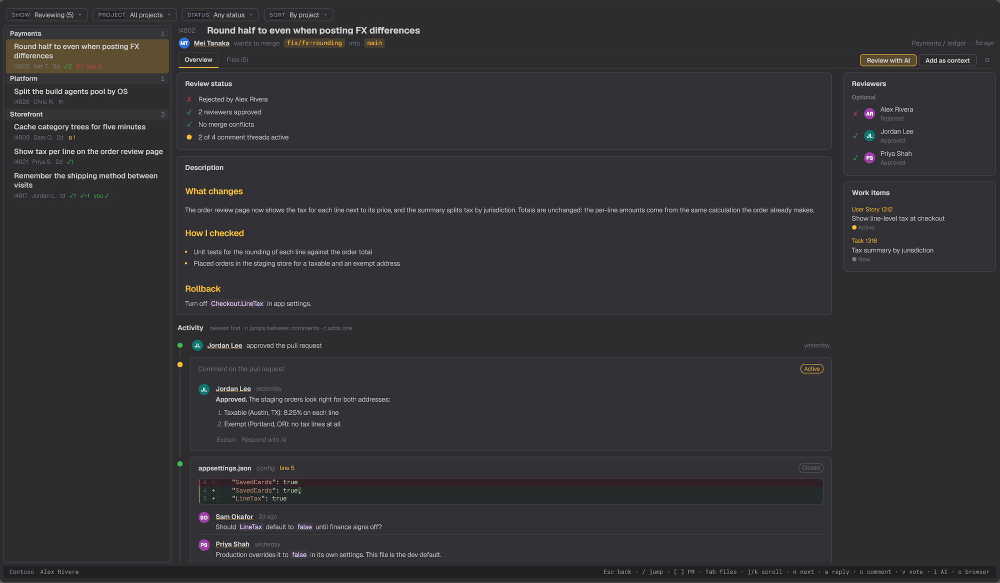

</div>

## Why

Reviewing in Azure DevOps usually means a browser tab per pull request. tern-azdo puts the whole organization in one list and keeps you in the terminal from "what needs my review" to "approved". It's one Rust binary with no runtime, and it draws real Tern surfaces (tabs, tables, syntax-highlighted diffs) instead of text art. It's the Tern counterpart to the [AzDO Pull Requests (Multi-Project)](https://github.com/zachristmas/vscode-pull-request-azdo) VS Code extension.

## Features

**One navigator for the organization.** A rail of PR cards sits beside the open pull request and never goes away, so any PR is one click from any other. Each card has the whole title, the PR id, author, age, vote counts and your own vote, grouped by project. Four dropdowns across the top filter it everywhere: Show (reviewing, created by me, all active), Project, Status (ready, draft, approved, blocked) and Sort (by project, newest first, oldest first, across every project). `[` and `]` step to the previous and next PR. Each project folds: click its header to collapse it.

**A picker for narrow panes.** Below about 110 columns, or when you hide the sidebar with the button at the top left, the rail gives way to the PR at full width with a compact bar above it: a Pull requests button, and previous and next. The button (or `Ctrl+K`, anywhere) opens the picker: a search field over a scrollable list of the same cards, with the same Show, Project, Status and Sort filters. Type to search by title, author, repo, branch or id, `↑↓` cycle through the list (wrapping), `←→` collapse and expand the project you are in, and Enter opens. Esc on a narrow PR comes back to the picker. The width is read from the pane, and a narrow pane starts in the picker.

<p align="center">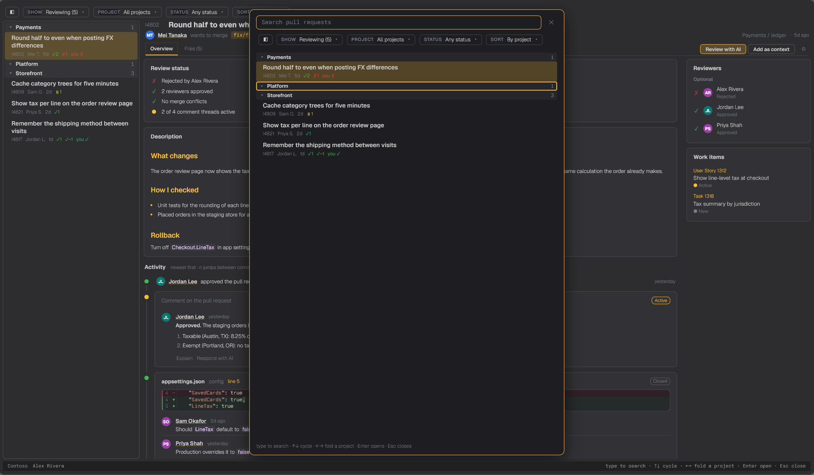</p>

<table align="center"><tr>
<td>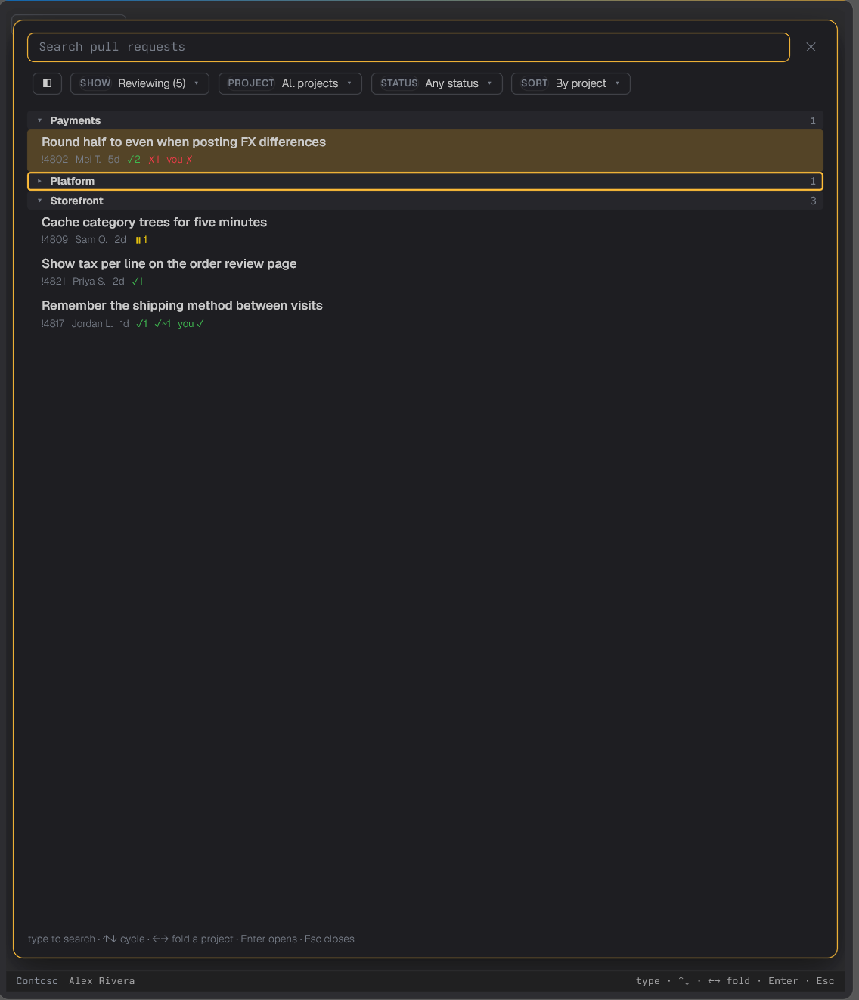</td>
<td>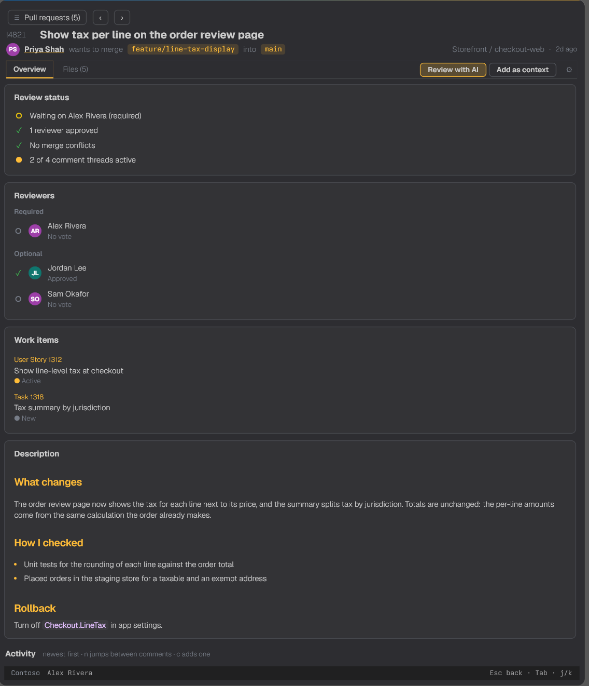</td>
</tr></table>

Sort by newest or oldest and the list runs across every project at once. With the project headers gone, each card carries its project (a colored dot) and repo, so you always know where a PR lives.

<p align="center">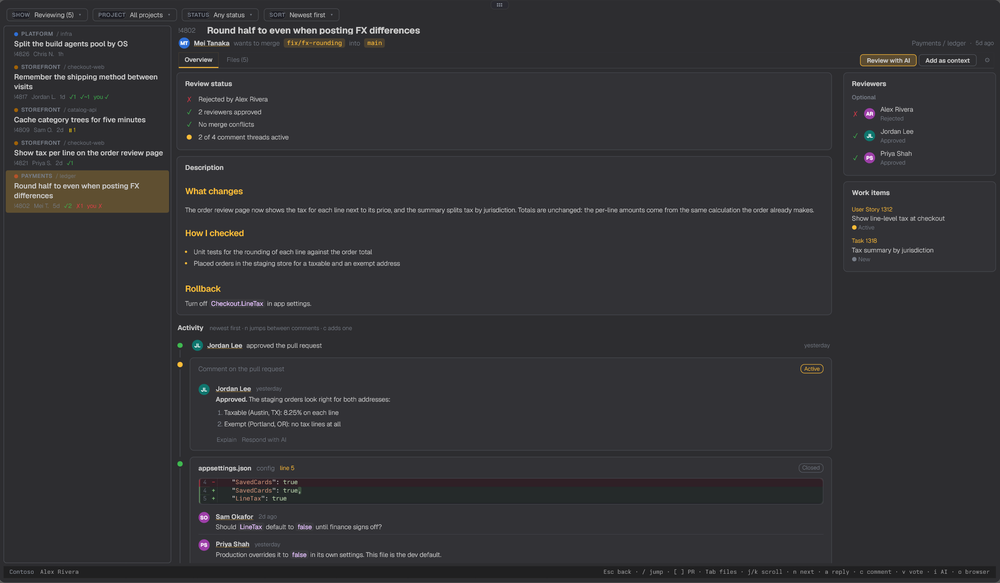</p>

**A page per pull request.** A status card says where the PR stands: who approved, who is waiting or rejected, required reviewers still to vote, merge conflicts, and how many comment threads are open. The description renders as Markdown, and reviewers and linked work items sit beside it.

<p align="center">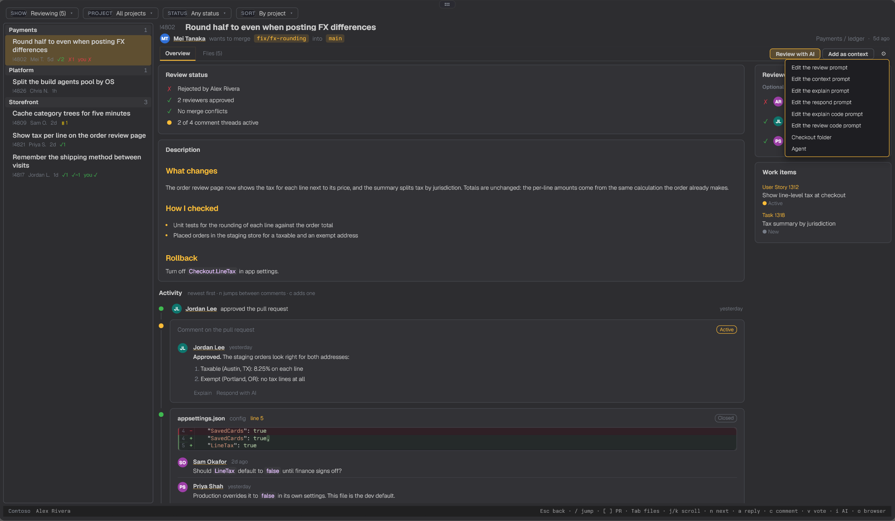</p>

**The whole conversation, in order.** Under the description, the activity timeline lists everything newest first: votes, pushes, reviewers being added, and every comment thread. Each thread is its own card with the file, its line range, the code it is about and its status (Active, Resolved, Won't fix). Every comment in it shows in full, with the author's name and initials, when they wrote it, whether it was edited, and its Markdown (lists, bold, code). `n` jumps from thread to thread, and `a` replies to the one you are on. Each thread has Explain and Respond with AI buttons (below).

<p align="center">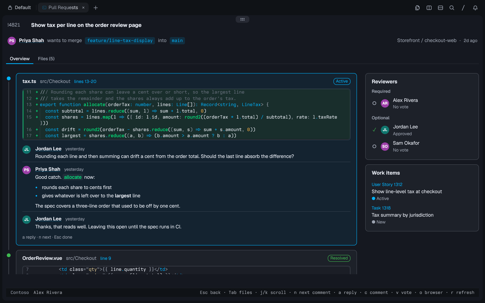</p>

**Diffs you can read.** The changed files sit in a folder tree beside a syntax-highlighted diff with real line numbers. Comment threads appear inside the diff, right under the lines they are about, and the tree marks which files have comments. `s` switches between inline and side by side, `x` between changes and the whole file, and the diff scrolls on its own with the vim keys. `n` jumps to the next comment, moving across files. `}` and `{` jump to the next and previous change, like vim, going on to the next file at the end of one; the whole file view opens five lines above its first change. To comment on a line, click its line number: a comment box opens under it, as in Azure DevOps. From the keyboard, `c` asks for the line number (`-12` for a removed line).

<p align="center">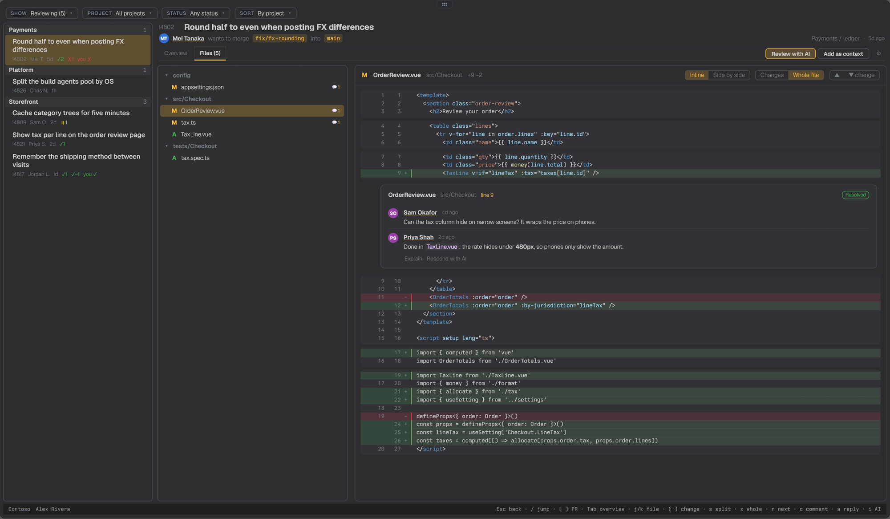</p>

<p align="center">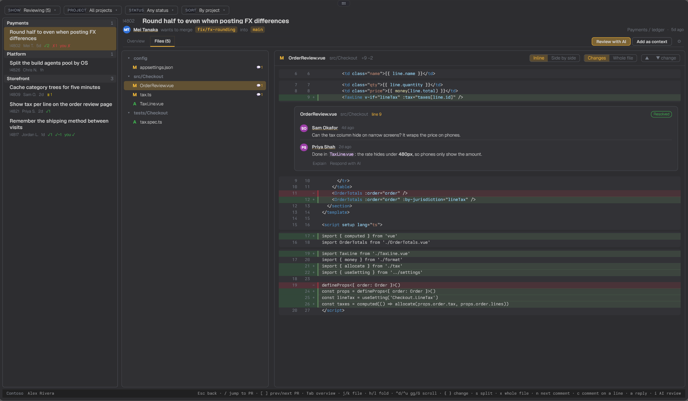</p>

**Sizes you set once.** The Aa button above the file tree sets the diff's text size, the tree's text size and the tree's width, one step at a time (or `+` `-` and `< >` on the Files tab). They are saved in `config.json` and kept across restarts, and Reset sizes puts the defaults back.

**Filter the files, select some, review just those.** The filter box above the tree takes comma-separated terms: a plain term matches loosely like a fuzzy finder (`ordrvw`), `*.config` or `src/**/Tax*` is a glob, `/\.vue$/` is a regex (commas allowed inside), and a leading `!` leaves out what matches. Tick the boxes beside files and folders (or press Space on a file, Ctrl+A for everything shown) and Review selected and Add selected as context appear above the tree. They go through the same confirmation and templates as the rest, with `{selected}` and `{selected_count}` available.

<p align="center">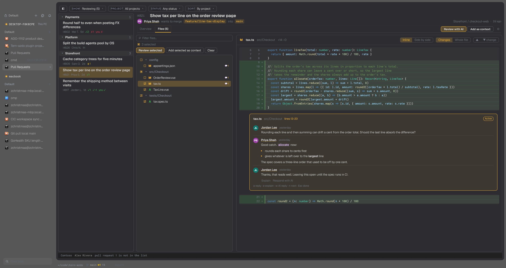</p>

<p align="center">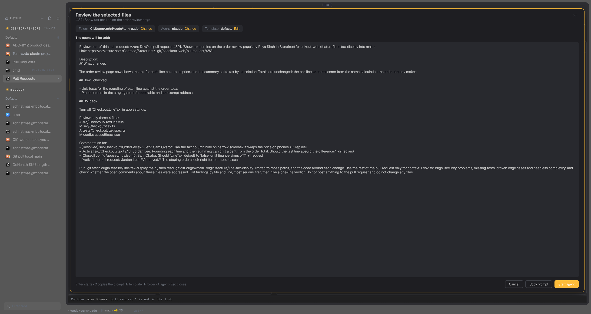</p>

**Your agent can drive it.** Anything you can do by hand an agent can do in front of you over MCP or the command line: open a pull request, jump to a comment on the overview or on the diff, to a file or a line, filter the tree to `*.config` changes, tick files, or put a search into the picker. It can read what you are looking at and list the PRs, files and comments to choose from, so a loose request ("show me the config changes in the ledger PR") turns into a few calls. See below.

**Review with AI.** Two buttons at the top of every PR start a coding agent in a new Tern block, beside the plugin, in your local checkout of that repo: Review with AI (`i`) asks for a review of the diff, and Add as context (`t`) has it read the PR and wait for your questions. On a comment thread, Explain (`e`) and Respond with AI (`w`) ask the agent to explain the comment or draft a reply. Click a line number in the diff and the comment box has Explain with AI and Review with AI for that line, with the code around it and anything you have typed so far. Nothing is posted to the PR; the agent only reads and answers.

<p align="center">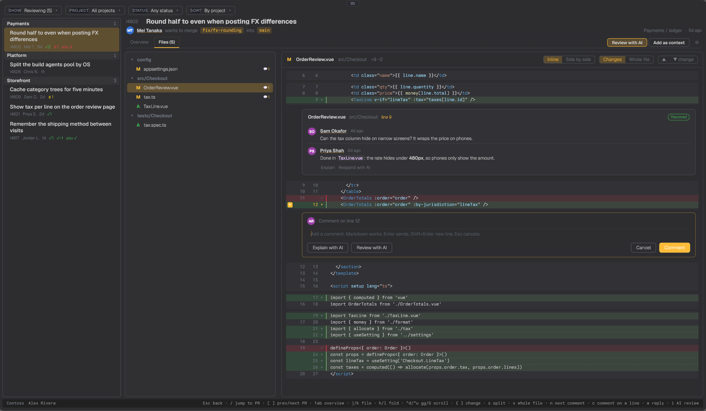</p>

**See it before it runs.** Every one of those opens a confirmation first. It shows exactly what the agent will be told, with the PR's real description, files and comments filled in, plus the folder it will run in, the agent and the template, each with a Change or Edit link. Enter starts it, Esc closes it, and Copy prompt (`C`) puts the filled-in prompt on the clipboard instead, for pasting into an agent that is already running.

**Pick the agent.** Claude Code runs by default. Change the agent in that confirmation to pick claude, codex or omp with one click, or type any command line. The choice applies to that repo; Use for every repo makes it the default, which every repo without its own agent follows. From the command line, `tern-azdo agent omp` sets the default and `tern-azdo agent --reset` puts claude back.

<p align="center">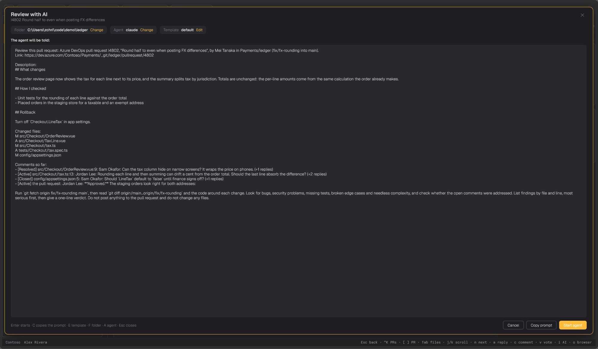</p>

**A template per kind, per repo.** Edit lets you rewrite the template with the filled-in result live underneath. Every kind (review, context, explain, respond, explain code, review code) starts from a default that runs `git fetch`, reads the diff and the code, and reports without touching anything, so most people never change it. The variables are `{id} {title} {url} {project} {repo} {source} {target} {author} {description} {files} {comments}`, plus `{thread} {file} {line} {comment} {code}` for comment and line prompts. A template you never changed is not saved, so better defaults reach you. The gear (`I`) opens the same editor without starting anything.

<p align="center">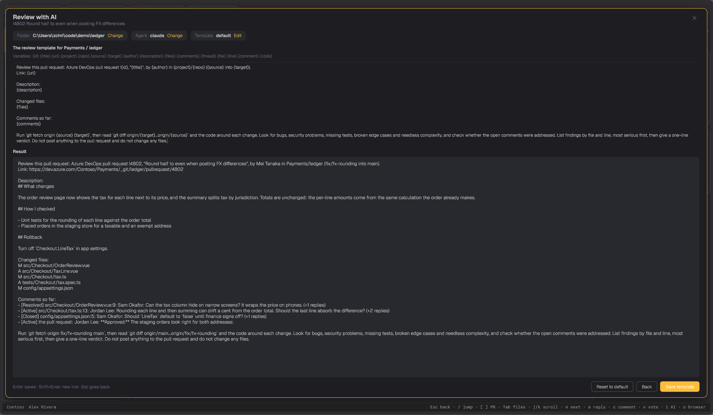</p>

**One field for the folder.** The first time in a repo, tern-azdo looks where it was started (that folder's clone, or a folder named like the repo inside or beside it) and uses it without asking. If it finds none, the folder field opens already filled with the path it started in. Everything up to the last `\` or `/` is the folder listed; what follows filters it, so editing the path is how you search: delete the last name to see its siblings, add a separator to look inside. Tab or a click opens the highlighted folder, left goes up, and Enter uses it. Only the one folder is read, so it stays instant on big drives.

<p align="center">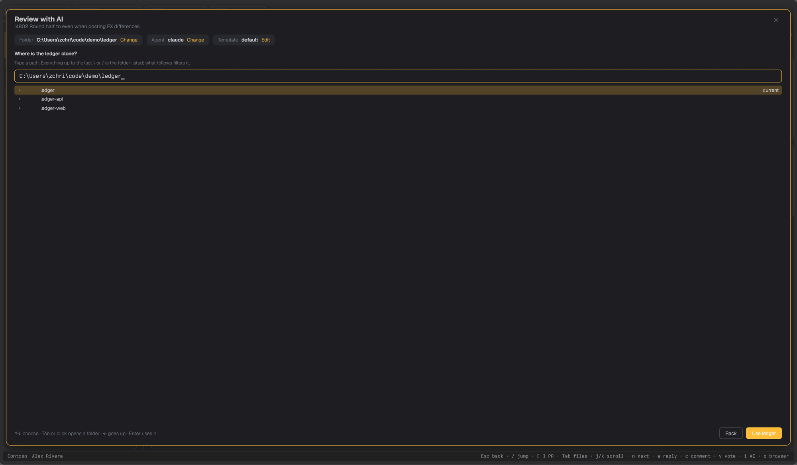</p>

**You can see it is running.** The button that started an agent reads "Running" for a while and then comes back to ready, so a second click does not start a second agent by accident.

<p align="center">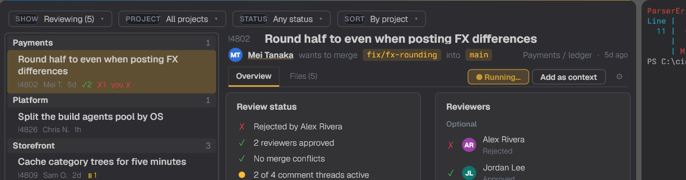</p>

**Review without leaving.** Vote (approve, approve with suggestions, wait for author, reject), start a comment thread, or reply to one. Open the PR in the browser, or copy its link or source branch.

**Nothing to store.** Sign-in goes through the Azure CLI's existing `az login`. A personal access token in the OS credential store works too.

## Try it

You need [Tern](https://stencil.so/tern) and a stable Rust toolchain (2024 edition, Rust 1.85 or newer).

```sh
git clone https://github.com/zachristmas/tern-azdo
cd tern-azdo
cargo install --path .
tern plugin link plugin
tern-azdo --demo        # a made-up organization, no account needed
```

For your own organization, sign in with the [Azure CLI](https://learn.microsoft.com/cli/azure/install-azure-cli) (`az login`), then open the Tern command palette:

| Command | What it does |
|---|---|
| Azure DevOps: Pull Requests | Opens the list in a new tab |
| Azure DevOps: Pull Requests Beside Current Pane | Opens it in a split to the right |

## Organization and sign-in

tern-azdo finds the organization from, in order: the `AZDO_ORG` environment variable, the saved config, then the `origin` remote of the directory it starts in. With none of those, it asks on first run. `tern-azdo org Contoso` (or any `dev.azure.com` or repo URL) saves it to `%APPDATA%\tern-azdo\config.json` on Windows and `~/.config/tern-azdo/config.json` elsewhere. The file holds no secrets.

Tokens come from `az account get-access-token`, so a working `az login` is all it needs. To use a personal access token instead (scopes: Code, Read & Write; Work Items, Read), run `tern-azdo pat` and paste it. It goes into the OS credential store (Windows Credential Manager, macOS Keychain, Secret Service on Linux), and `tern-azdo pat --forget` removes it. `AZDO_PAT` also works, for scripts.

## Command line

```text
tern-azdo                         the interactive view
tern-azdo --demo                  the interactive view on made-up data
tern-azdo list [review|mine|all]  active pull requests as a table
tern-azdo org [ORG]               show or set the organization
tern-azdo pat [--forget]          save (from stdin) or remove a personal access token
tern-azdo prompts                 the prompt kinds, default templates and variables, as JSON
tern-azdo agent [NAME | --reset]  show or set the default agent (claude, codex, omp or a command line)
tern-azdo repos                   every repo with saved AI settings
tern-azdo repo show KEY           one repo's folder, agent and effective prompts
tern-azdo repo set KEY [--dir D] [--agent A]
tern-azdo repo prompt KEY KIND [--text T | --stdin | --reset]   print, set or reset one template
tern-azdo repo remove KEY         back to defaults
tern-azdo view [--prs W] [--threads W] [--files]   where you are, and what an agent could take you to
tern-azdo go [--pr N] [--tab overview|files] [--filter F] [--file F] [--line N] [--thread ID]
tern-azdo refresh [same fields as go]   reload the PR and the list, then go there
tern-azdo files [filter TEXT | select [TEXT] [--mode add|remove|set] | clear]
tern-azdo search TEXT             open the picker with TEXT typed in
tern-azdo dismiss                 close the picker and dialogs
tern-azdo mcp                     all of the above as an MCP server on stdio
```

Outside Tern, `tern-azdo list` prints a plain-text table, so it works in scripts and other terminals.

### Configuring the AI actions from an agent

`KEY` is `project/repo`, case-insensitive. The `repo` commands print JSON, and `repo set` and `repo prompt` warn about template variables that do not exist and folders that are missing. A template equal to the default is not saved, so defaults can still improve. In the same way, a repo whose agent is empty (`repo set KEY --agent ""`) runs the default agent. The plugin reads the config each time an AI action opens, so changes apply without a restart.

Everything is saved in `config.json` (`%APPDATA%	ern-azdo` on Windows, `~/.config/tern-azdo` elsewhere), next to nothing else of Tern's. For long templates, or ones with `|`, `<`, `>` or quotes that a shell would mangle, pass `prompts_file` to `azdo_ai_repo_set` (or `--prompts-file` to `repo set`): a JSON file of kind to template. A prompt over 20,000 characters (a big PR with long threads) would not fit a Windows command line, so the agent is started with a short message that points at a file in the temp folder holding it, and the confirmation says so.

To give an agent the same operations as tools, add the server to its MCP config:

```json
{ "mcpServers": { "tern-azdo": { "command": "tern-azdo", "args": ["mcp"] } } }
```

The settings tools are `azdo_ai_info` (read this first), `azdo_ai_default_agent`, `azdo_ai_repos`, `azdo_ai_repo_get`, `azdo_ai_repo_set` and `azdo_ai_repo_remove`.

### Driving the view from an agent

The running view reads commands from a file beside `config.json` about once a second and writes what it shows to `state.json`, so the CLI and MCP tools act on the view in front of you and report where it ended up. Start with `azdo_view`: it says which PR, tab, file and comment you are on, and with `prs`, `threads` or `files` set (to words, or true) it lists what could be opened, so an agent can match a loose request to a PR number, a comment id or a file path. Then `azdo_go` takes you there, in any mix: `pr`, `tab`, `filter`, `file` (a path or words it matches), `line`, `thread` (shown on the diff, or in the overview with `view: "overview"`). `azdo_files_filter` and `azdo_files_select` change the tree's filter and selection, `azdo_refresh` reloads the open PR (new commits, files, comments) and then takes you to a file, line or comment, so an agent that just pushed a fix can show it to you on the diff; `azdo_search` opens the picker with words typed in, and `azdo_dismiss` closes it. The filter syntax is the one in the box: `*.config, /^src\/Checkout/, !tests`. Opening a PR loads its files a moment later; `azdo_go` waits for them.

## Keys

<table>
<tr><th>Navigator</th><th>Pull request</th></tr>
<tr valign="top"><td>

| Key | Action |
|---|---|
| `↑` `↓`, `j` `k`, `PgUp` `PgDn` | Move |
| `gg` / `G` | First / last |
| `Ctrl+D` `Ctrl+U`, `d` `u` | Half a screen down / up |
| `Enter`, double-click | Open |
| `1` `2` `3`, `Tab` | Reviewing / mine / all |
| `f`, `Ctrl+F` | Filter (`Esc` clears) |
| `o` | Open in the browser |
| `y` / `b` | Copy link / branch |
| `r` | Refresh |
| `q`, `Ctrl+Q` | Quit |

</td><td>

| Key | Action |
|---|---|
| `Tab`, `1` / `2` | Overview / Files |
| `↑` `↓`, `j` `k` | Pick a file (Overview: scroll) |
| `h` `l`, `←` `→` | Fold / unfold the file's folder |
| `gg` / `G` | Top / bottom of the overview or diff |
| `Ctrl+D` `Ctrl+U`, `d` `u` | Half a screen down / up |
| `Ctrl+F` `Ctrl+B`, `Space` (Overview), `PgDn` `PgUp` | A screen down / up |
| `n` / `p` | Next / previous comment |
| `Space` / `Ctrl+A` | Files: select the file / every shown file (`Esc` unselects) |
| `F` | Files: filter the tree |
| `R` / `T` | AI review / add the selected files as context |
| `+` `-` / `<` `>` | Files: diff text bigger / smaller, file tree wider / narrower |
| `s` | Inline or side by side |
| `x` | Whole file or changes |
| `v` then `1` `2` `3` `4` `0` | Approve, with suggestions, wait, reject, reset |
| `c` / `a` | New comment (Files: on a line) / reply (`Enter` sends) |
| `}` / `{` | Next / previous change in the diff |
| `i` / `t` | AI review / add the PR as context |
| `e` / `w` | AI explain / reply on the selected comment |
| `I` | AI settings: templates, folder, agent |
| `Ctrl+K` | Open the picker: search and cycle through every PR |
| `[` / `]` | Previous / next PR |
| `Esc` | Leave the thread you are on (no sidebar: opens the picker) |

</td></tr>
</table>

## Platform support

| OS | Status |
|---|---|
| Windows | Built and run against a live organization |
| macOS, Linux | Should build (CI workflow included); not tested by hand |

## Roadmap

- [x] Start an AI agent on a PR, a comment or a diff line
- [x] Global navigator, filters and sorting across projects
- [ ] Check out the PR branch in a local clone
- [x] Comment on a diff line
- [ ] Policy and build status
- [ ] Complete (merge) and abandon
- [ ] Commits and iteration-to-iteration diffs

## Related

- [tern-mssql](https://github.com/zachristmas/tern-mssql): a SQL Server client for Tern, built the same way.
- [AzDO Pull Requests (Multi-Project)](https://github.com/zachristmas/vscode-pull-request-azdo): the VS Code extension this mirrors.

## License

[MIT](LICENSE)
