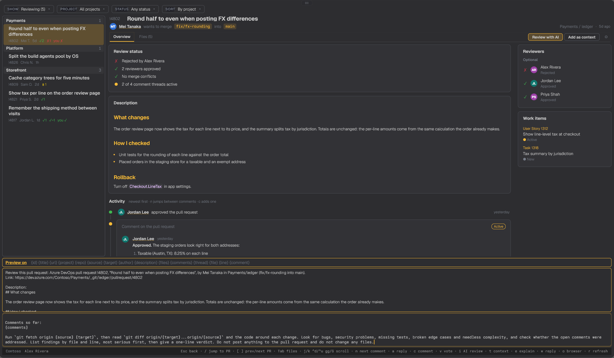

<div align="center">

# tern-azdo

**Azure DevOps pull requests, native in [Tern](https://stencil.so/tern).**

Every active PR in your organization, across all projects and repos, with diffs, comment threads, votes and an AI review one click away, in your terminal.

[](LICENSE)
[](https://www.rust-lang.org)
[](https://stencil.so/tern)
[](https://learn.microsoft.com/azure/devops/repos/git/pull-requests)


</div>

## Why

Reviewing in Azure DevOps usually means a browser tab per pull request. tern-azdo puts the whole organization in one list and keeps you in the terminal from "what needs my review" to "approved". It's one Rust binary with no runtime, and it draws real Tern surfaces (tabs, tables, syntax-highlighted diffs) instead of text art. It's the Tern counterpart to the [AzDO Pull Requests (Multi-Project)](https://github.com/zachristmas/vscode-pull-request-azdo) VS Code extension.

## Features

**One navigator for the organization.** A rail of PR cards sits beside the open pull request and never goes away, so any PR is one click from any other. Each card has the whole title, the PR id, author, age, vote counts and your own vote, grouped by project. Four dropdowns across the top filter it everywhere: Show (reviewing, created by me, all active), Project, Status (ready, draft, approved, blocked) and Sort (by project, newest first, oldest first, across every project). `/` or `Ctrl+K` opens a quick switcher that finds any PR by title, author, repo, branch or id, `[` and `]` step to the previous and next PR, and `f` filters by text. On a narrow pane the rail and the PR take turns.

**A page per pull request.** A status card says where the PR stands: who approved, who is waiting or rejected, required reviewers still to vote, merge conflicts, and how many comment threads are open. The description renders as Markdown, and reviewers and linked work items sit beside it.

<p align="center"></p>

**The whole conversation, in order.** Under the description, the activity timeline lists everything newest first: votes, pushes, reviewers being added, and every comment thread. Each thread is its own card with the file, its line range, the code it is about and its status (Active, Resolved, Won't fix). Every comment in it shows in full, with the author's name and initials, when they wrote it, whether it was edited, and its Markdown (lists, bold, code). `n` jumps from thread to thread, and `a` replies to the one you are on. Each thread has Explain and Respond with AI buttons (below).

<p align="center"></p>

**Diffs you can read.** The changed files sit in a folder tree beside a syntax-highlighted diff with real line numbers. Comment threads appear inside the diff, right under the lines they are about, and the tree marks which files have comments. `s` switches between inline and side by side, `x` between changes and the whole file, and the diff scrolls on its own with the vim keys. `n` jumps to the next comment, moving across files. `}` and `{` jump to the next and previous change, like vim, going on to the next file at the end of one; the whole file view opens five lines above its first change. To comment on a line, click its line number: a comment box opens under it, as in Azure DevOps. From the keyboard, `c` asks for the line number (`-12` for a removed line).

<p align="center"></p>

**Review with AI.** Two buttons at the top of every PR start a coding agent in a new Tern block, beside the plugin, in your local checkout of that repo: Review with AI (`i`) asks for a review of the diff, and Add as context (`t`) has it read the PR and wait for your questions. On a comment thread, Explain (`e`) and Respond with AI (`w`) ask the agent to explain the comment or draft a reply. The first time in a repo it asks for the checkout folder (prefilled when you start from a clone) and the agent: `claude`, `codex`, or any command line, with `{prompt}` marking where the prompt goes. Nothing is posted to the PR; the agent only reads and answers.

The gear (`I`) edits each prompt per repo. Every prompt starts as a default that needs no changes, and the editor lists the variables it can use: `{id} {title} {url} {project} {repo} {source} {target} {author} {description} {files} {comments}`, plus `{thread} {file} {line} {comment}` for comment prompts. `Ctrl+P` previews the prompt with those filled in. Settings are saved in `config.json` next to the organization; a prompt you never changed is not saved, so improved defaults reach you.

<p align="center"></p>

**Review without leaving.** Vote (approve, approve with suggestions, wait for author, reject), start a comment thread, or reply to one. Open the PR in the browser, or copy its link or source branch.

**Nothing to store.** Sign-in goes through the Azure CLI's existing `az login`. A personal access token in the OS credential store works too.

## Try it

You need [Tern](https://stencil.so/tern) and a stable Rust toolchain (2024 edition, Rust 1.85 or newer).

```sh
git clone https://github.com/zachristmas/tern-azdo
cd tern-azdo
cargo install --path .
tern plugin link plugin
tern-azdo --demo        # a made-up organization, no account needed
```

For your own organization, sign in with the [Azure CLI](https://learn.microsoft.com/cli/azure/install-azure-cli) (`az login`), then open the Tern command palette:

| Command | What it does |
|---|---|
| Azure DevOps: Pull Requests | Opens the list in a new tab |
| Azure DevOps: Pull Requests Beside Current Pane | Opens it in a split to the right |

## Organization and sign-in

tern-azdo finds the organization from, in order: the `AZDO_ORG` environment variable, the saved config, then the `origin` remote of the directory it starts in. With none of those, it asks on first run. `tern-azdo org Contoso` (or any `dev.azure.com` or repo URL) saves it to `%APPDATA%\tern-azdo\config.json` on Windows and `~/.config/tern-azdo/config.json` elsewhere. The file holds no secrets.

Tokens come from `az account get-access-token`, so a working `az login` is all it needs. To use a personal access token instead (scopes: Code, Read & Write; Work Items, Read), run `tern-azdo pat` and paste it. It goes into the OS credential store (Windows Credential Manager, macOS Keychain, Secret Service on Linux), and `tern-azdo pat --forget` removes it. `AZDO_PAT` also works, for scripts.

## Command line

```text
tern-azdo                         the interactive view
tern-azdo --demo                  the interactive view on made-up data
tern-azdo list [review|mine|all]  active pull requests as a table
tern-azdo org [ORG]               show or set the organization
tern-azdo pat [--forget]          save (from stdin) or remove a personal access token
```

Outside Tern, `tern-azdo list` prints a plain-text table, so it works in scripts and other terminals.

## Keys

<table>
<tr><th>Navigator</th><th>Pull request</th></tr>
<tr valign="top"><td>

| Key | Action |
|---|---|
| `↑` `↓`, `j` `k`, `PgUp` `PgDn` | Move |
| `gg` / `G` | First / last |
| `Ctrl+D` `Ctrl+U`, `d` `u` | Half a screen down / up |
| `Enter`, double-click | Open |
| `1` `2` `3`, `Tab` | Reviewing / mine / all |
| `f`, `Ctrl+F` | Filter (`Esc` clears) |
| `o` | Open in the browser |
| `y` / `b` | Copy link / branch |
| `r` | Refresh |
| `q`, `Ctrl+Q` | Quit |

</td><td>

| Key | Action |
|---|---|
| `Tab`, `1` / `2` | Overview / Files |
| `↑` `↓`, `j` `k` | Pick a file (Overview: scroll) |
| `h` `l`, `←` `→` | Fold / unfold the file's folder |
| `gg` / `G` | Top / bottom of the overview or diff |
| `Ctrl+D` `Ctrl+U`, `d` `u` | Half a screen down / up |
| `Ctrl+F` `Ctrl+B`, `Space`, `PgDn` `PgUp` | A screen down / up |
| `n` / `p` | Next / previous comment |
| `s` | Inline or side by side |
| `x` | Whole file or changes |
| `v` then `1` `2` `3` `4` `0` | Approve, with suggestions, wait, reject, reset |
| `c` / `a` | New comment (Files: on a line) / reply (`Enter` sends) |
| `}` / `{` | Next / previous change in the diff |
| `i` / `t` | AI review / add the PR as context |
| `e` / `w` | AI explain / reply on the selected comment |
| `I` | AI settings: prompts, checkout, agent |
| `/`, `Ctrl+K` | Jump to any PR |
| `[` / `]` | Previous / next PR |
| `Esc` | Leave the thread you are on (narrow pane: back to the navigator) |

</td></tr>
</table>

## Platform support

| OS | Status |
|---|---|
| Windows | Built and run against a live organization |
| macOS, Linux | Should build (CI workflow included); not tested by hand |

## Roadmap

- [x] Start an AI agent on a PR or a comment
- [ ] Check out the PR branch in a local clone
- [x] Comment on a diff line
- [ ] Policy and build status
- [ ] Complete (merge) and abandon
- [ ] Commits and iteration-to-iteration diffs

## Related

- [tern-mssql](https://github.com/zachristmas/tern-mssql): a SQL Server client for Tern, built the same way.
- [AzDO Pull Requests (Multi-Project)](https://github.com/zachristmas/vscode-pull-request-azdo): the VS Code extension this mirrors.

## License

[MIT](LICENSE)
